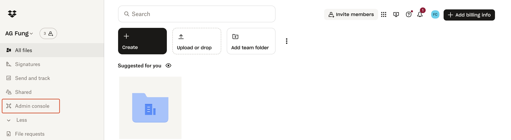
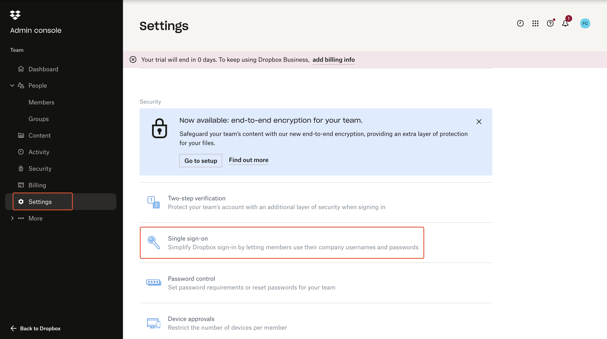
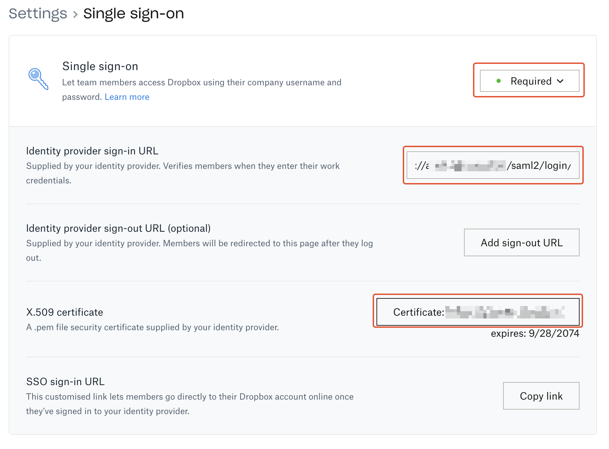

# Use Authgear as SAML Identity Provider for Dropbox

Security Assertion Markup Language (SAML) is a standard that allows an Identity Provider (IdP) and a Service Provider (SP) to perform user authentication and authorization without exchanging a user's password.

In this post, you'll learn how to set up Authgear as an Identity Provider and Dropbox as a Service Provider.

### Prerequisites

* An Authgear account. Sign up for free.
* A Dropbox Business Advanced account.
* Email login enabled in your Authgear project. Authgear sends the user's email address to Dropbox, so every user who signs in to Dropbox needs one.

### Step 1: Create an Authgear Client Application

You need an Authgear client application with SAML 2.0 support to use Authgear as a SAML identity provider.

1. Log in to Authgear Portal, select your project, and go to **Applications**.
2. Click **Add Application**.
3. Enter a **Name** for the application, for example `Dropbox`.
4. Under **Framework**, in the **Other** section, select **Other OIDC/SAML compatible**.
5. Click **Create application**.

The application opens on its **Quick Start** tab.


Only applications created with **Other OIDC/SAML compatible** have a **SAML 2.0** tab. To reuse an existing application, check that it has this tab, then skip to Step 2.


### Step 2: Enable SAML 2.0 in Client Application

In your Authgear client application, open the **SAML 2.0** tab and turn on **SAML 2.0 Support**.

Then configure the following:

* **NameID Format**: `urn:oasis:names:tc:SAML:1.1:nameid-format:emailAddress`
* **Allowed Assertion Consumer Service URLs (ACS URLs)**: the Dropbox post-back URL:

  ```
  https://www.dropbox.com/saml_login
  ```

Click **Save** to keep your changes.

### Step 3: Get SAML IdP Configuration and Download Certificate

Still on the **SAML 2.0** tab, go to the **Configuration Parameters** section and note the **Login URL**.

Next, in the **Identity Provider Certificates** section, click **Download Certificate**.

You'll use the Login URL and certificate later in the Dropbox Admin console.

### Step 4: Add Authgear SAML IdP in Dropbox

Log in to your Dropbox Business Advanced account then click on **Admin console** in the navigation menu.

<figure><figcaption></figcaption></figure>

In the Dropbox Admin console navigate to **Settings** > **Single sign-on**.

<figure><figcaption></figcaption></figure>

Now in the Dropbox Single sign-on settings page, set Single sign-on to **Required**. Then, configure the following:

* Paste the value for your Authgear client application's `Login URL` in the `Identity provider sign-in URL` field.
* Under **X.509 certificate**, click on the Certificate upload button, then upload the Identity Provider Certificate you downloaded from your Authgear client application in the previous step.

<figure><figcaption></figcaption></figure>

### Step 5: Login to Dropbox Using Authgear SAML

To test your SAML implementation, you need to add a new user to your Dropbox with an email address that is associated with a user account in your Authgear project.

To add a new user to your Dropbox, navigate to **Admin console** > **People** > **Members** > **Invite member**.

Accept the invite for the new user, and try to log in to Dropbox using the registered email address for the new user. You should be redirected to the Authgear SAML login page. On successful login to the Authgear account, you should be redirected and signed in to Dropbox.&#x20;