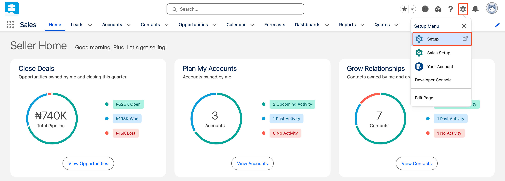
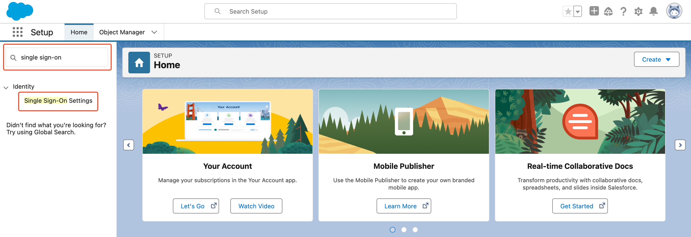
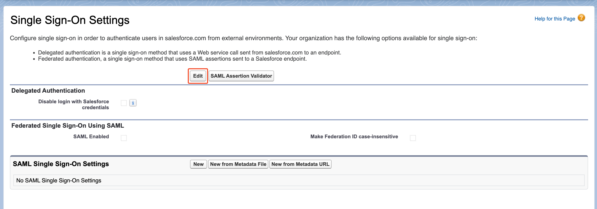
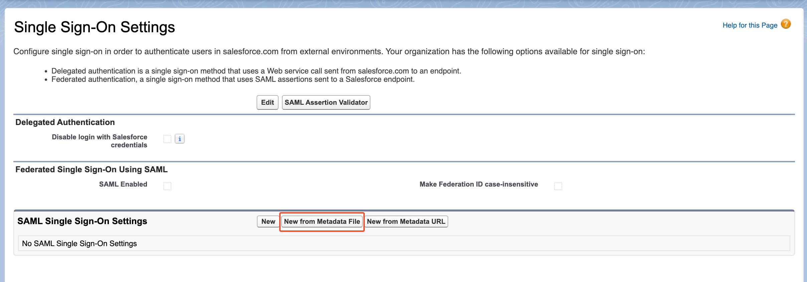
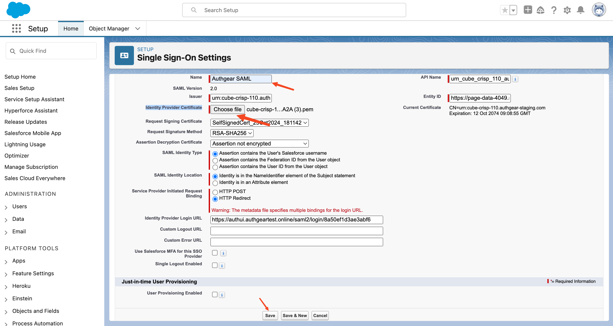
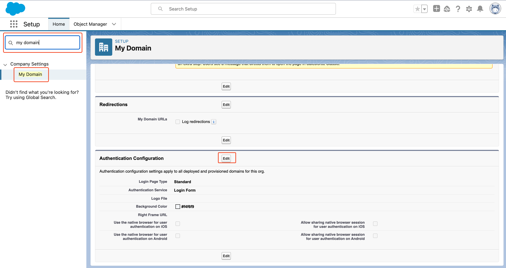
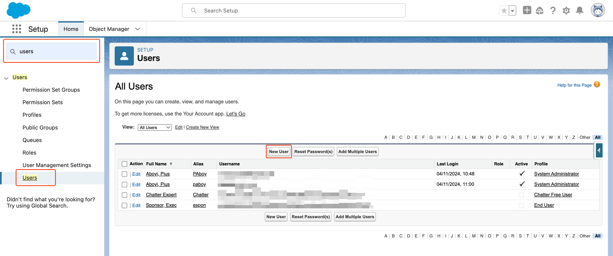
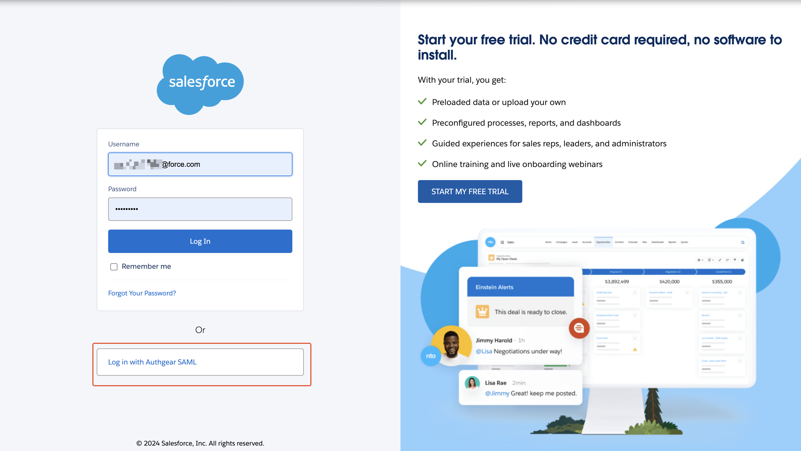

# Use Authgear as SAML Identity Provider for Salesforce

Security Assertion Markup Language or short [SAML](https://docs.oasis-open.org/security/saml/Post2.0/sstc-saml-tech-overview-2.0.html) is a standard for exchanging security information between businesses. In SAML, one party acts as the Identity Provider (IdP) and the other party is the Service Provider (SP).

The Service Provider (SP) trust the Identity Provider to handle the process of user authentication. The Identity Provider handles user authentication and notifies the Service Provider once the user is authenticated.

In this guide, you'll learn how to set up SAML with Authgear as an Identity Provider (IdP) and Salesforce as the Service Provider (SP) in SAML.

### Prerequisites

* An Authgear account. [Sign up](https://authgear.com) for free.
* A Salesforce account.
* Email login enabled in your Authgear project. Authgear sends the user's email address to Salesforce, so every user who signs in to Salesforce needs one.

### Step 1: Create an Authgear Client Application

You need an Authgear client application with SAML 2.0 support to use Authgear as a SAML Identity Provider.

1. Log in to Authgear Portal, select your project, and go to **Applications**.
2. Click **Add Application**.
3. Enter a **Name** for the application, for example `Salesforce`.
4. Under **Framework**, in the **Other** section, select **Other OIDC/SAML compatible**.
5. Click **Create application**.

The application opens on its **Quick Start** tab.


Only applications created with **Other OIDC/SAML compatible** have a **SAML 2.0** tab. To reuse an existing application, check that it has this tab, then skip to Step 2.


### Step 2: Enable SAML 2.0 in Client Application

In your Authgear client application, open the **SAML 2.0** tab and turn on **SAML 2.0 Support**.

Then configure the following:

* **NameID Format**: `urn:oasis:names:tc:SAML:1.1:nameid-format:emailAddress`
* **Allowed Assertion Consumer Service URLs (ACS URLs)**, under **SSO Settings**: your Salesforce domain. Find it on the **My Domain** page in Salesforce Setup.

Click **Save** to keep your changes.

### Step 3: Get SAML Identity Provider (IdP) Configuration and Download Certificate

Still on the **SAML 2.0** tab, go to the **Configuration Parameters** section and click **Download Metadata** to download the Identity Provider Metadata XML file for your Authgear application.

Next, in the **Identity Provider Certificates** section, click **Download Certificate**.

You will use the downloaded metadata file and certificate in later steps.

### Step 4: Enable SAML in Salesforce

To enable SAML in Salesforce, login to your Salesforce account, click on the Settings icon on the top right corner then select Setup. This will open the Salesforce Setup page.

<figure><figcaption></figcaption></figure>

On the Setup page, type "single sign-on" in the **Quick find** search box on the left. Select **Single Sign-On** from the result to open the **Single Sign-On Settings** page.

<figure><figcaption></figcaption></figure>

Next, click on the **Edit** button under Select Single Sign-On Settings then check the **SAML Enabled** box under **Federated Single Sign-On Using SAML**. Click **Save** to keep your changes.

<figure><figcaption></figcaption></figure>

### Step 5: Add Authgear as SAML IdP in Salesforce

To add Authgear as a SAML Identity Provider, return to the main page of Single Sign-On Settings.&#x20;

<figure><figcaption></figcaption></figure>

Next, click on the **New from Metadata File** button. Then, click Choose file, and select the Metadata XML file you downloaded in [Step 3](use-authgear-as-saml-identity-provider-for-salesforce.md#step-3-get-saml-identity-provider-idp-configuration-and-download-certificate). Click on Create to continue.

On the next screen, you should see configurations for your new SAML IdP, including the details from the metadata file. Edit the **Name** field to Authgear SAML. The value for the Name field will be visible on your Salesforce login page.

Next, click on the Choose file button next to Identity Provider Certificate then select the SAML IdP Certificate file you downloaded in [Step 3](use-authgear-as-saml-identity-provider-for-salesforce.md#step-3-get-saml-identity-provider-idp-configuration-and-download-certificate) from your computer.

<figure><figcaption></figcaption></figure>

Once you're done with the above configurations, click **Save** to finish.

### Step 6: Enable Login with SAML in Salesforce

In order to log in with a specific SAML IdP, you must first enable the provider in Salesforce.

To enable your new SAML IdP (Authgear SAML) search for "my domain" in Quick find. Click on My Domain from the result. On the My Domain page, scroll to **Authentication Configuration** then click on the Edit button.

<figure><figcaption></figcaption></figure>

You should find your Authgear SAML IdP under **Authentication Service**. Check the box next to Authgear SAML to enable it. Click **Save** to keep changes.

Once you have enabled your SAML Identity provider in this step, it will be visible on your Salesforce login page the next time you attempt login.

### Step 7: Log in to Salesforce using Authgear SAML &#x20;

Before you can log in to your Salesforce project using Authgear SAML, you need to create a user using an email address that is linked to a user account in your Authgear project.

To create a user in Salesforce, use type "users" in the Quick find search box, then select **Users** > **Users** from the result. This will take you to the All Users page.

From the All Users page, click on **New User**. Create a new user with an email address that's linked to an account on your Authgear project.

<figure><figcaption></figcaption></figure>

Now, to test your SAML implementation, log out of Salesforce and attempt logging in again. This time, you should see a Login with Authgear SAML button.&#x20;

When you click on Login with Authgear SAML, you should be redirected to Authgear Login page. Login to the account on your Authgear project that has the same email address as the new user you created earlier in this step. You should be successfully logged in to your Salesforce project.

<figure><figcaption></figcaption></figure>